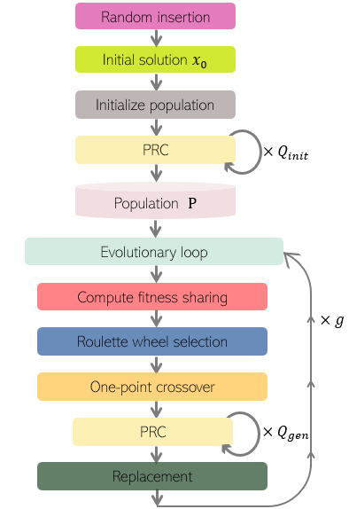

# EvoPRC

## Paper
- Jieun Yook, Hybrid Genetic Algorithm with Neural Local Search for Large Scale Traveling Salesman Problems, to appear in *Proc. IEEE International Conference on Evolving and Adaptive Intelligent Systems 2026 (IEEE EAIS 2026)*, 2026. [[PDF]](Hybrid Genetic Algorithm with Neural Local Search for Large Scale Traveling Salesman Problems.pdf)

## Acknowledgements
EvoPRC's code implementation is based on the open-source implementation of SIL (CIAM-Group/SIL: `https://github.com/CIAM-Group/SIL.git`).
We sincerely thank the authors for making their code publicly available.
Please visit the link above to download the dataset and the corresponding checkpoints.

## EvoPRC Framework



## Evaluation

You can run the evaluation with:

```bash
python test_PRC.py
```

Note:You need to modify the file/directory structure before running the script.


